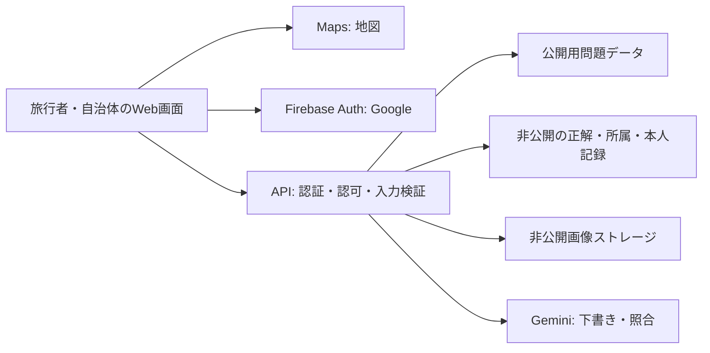

# 技術・データ・権限設計 v0.3

状態: 初期構成案と現行実装を併記。審査の入口と確認範囲は[共有検証手順](team-preview.md#提出・審査で使う手順)を参照。技術採用・課金・リージョン確定・実デプロイは、この資料だけでは実行しない。

## 1. 構成と比較

スマートフォン向けのWebアプリを提案する。自治体向け画面は同じコードベースで実装し、PCにも対応する。ネイティブアプリの配布、独自モデルの学習、専用の検索基盤はMVPの対象外とする。

| 層 | 第一候補 | 役割 |
|---|---|---|
| UI | React / TypeScript / Vite | 全国地図、Google認証導線、カメラ、登録画面 |
| 公開 | Cloud Run（共有検証） / Firebase Hosting（静的プレビュー） | 共有Web/APIと静的配信を区別。GitHub Pages不使用 |
| 認証 | Firebase Authentication | Googleログイン、サーバーでIDトークン検証 |
| API | Node HTTPサーバー / Cloud Run（共有検証） | 認可、公開処理、位置検査、AI呼び出し、記録確定。Functionsは初期案 |
| データ | Firestore | 公開問題、非公開の正解、所属、記録、処理状態 |
| 画像 | Cloud Storage for Firebase | 非公開の参考画像・一時回答・記録画像 |
| 地図 | Google Maps JavaScript API | 地図と探索エリア表示。Placesは初期必須でない |
| AI | Google Cloud側のGemini呼び出し | 小規模試験はVertex AI。モデル・接続先・確認状況は[試験設定](vertex-trial.md)。本番構成・クレジット適用は未確認 |

Google AI Studio側のGemini APIへ勝手に変更しない。小規模試験は[決定D-13](decisions.md)の条件で進める。クレジット対象・一般利用者のデータ利用条件・本番モデルとリージョンは要確認。サーバー認証は実行サービスアカウントとADCを優先し、長期秘密鍵の配布を避ける。[S3](sources.md)

MVP案では、アプリのデータをAPI経由で取得・変更する。ブラウザは主に認証にFirebaseを使う。ブラウザからDB/Storageに直接アクセスする例外は、別に設計して検証する。サーバーSDKにはFirestoreルールが適用されないため、API内での認可が必須となる。[S4](sources.md)

## 2. 公開・非公開の境界

Firestoreは文書単位で読み取りが許可される。公開問題の同じ文書に正解を入れ、画面だけで隠すことはしない。[S4](sources.md)

| データ／概念 | 主な項目 | 開示範囲 |
|---|---|---|
| organizations | 表示名、状態 | 旅行者向けには必要な表示名だけ |
| memberships | uid、orgId、role、active | サーバー・運営。権限操作は運営のみ |
| areas | 公開ポリゴン、代表点、件数 | 公開。代表点は対象の位置から作らない |
| places | placeId、対象名、正確な位置、権利・撮影確認 | サーバー・所属担当者 |
| quests | questId、orgId、placeId、status、publishedVersion、draftRevision | サーバー・所属担当者 |
| questVersions | 問題、ヒント、照合画像、確認済み特徴、撮影地点群と半径、利用条件 | 非公開、版は不変 |
| questPublic | questId、version、title、clue、areaId、公開部分画像、利用条件 | 公開中のallowlist項目だけ |
| challenges | uid、questId、version、作成時刻 | 本人・サーバー |
| attempts | 回答ID、所有者、入力hash、結果、処理状態、期限 | 本人は結果の要約のみ |
| discoveries | uid＋placeIdの一意キー、初回日時、写真参照、questId/version、紹介snapshot | 本人だけ |
| reports / auditEvents | 問題報告、操作・公開版・担当者、処理時刻 | 必要な担当者・運営。画像や移動履歴は含めない |

正解の写真や座標をクライアントの静的fixture、ビルド成果物、公開リポジトリに含めない。公開ヒント画像は全景とは別オブジェクトにする。最終ヒントを開く明示操作、本人のクリア後表示、管理権限のある操作だけが通常公開DTOの例外。

## 3. 組織権限

Firebaseの認証と自治体の所属認可を分ける。IDトークンからuidを確定し、membershipのactive・orgId・roleを照合する。URLやbodyのorgId、メールの見た目、クライアントのroleだけでは認可しない。[S2](sources.md)

編集者は自組織下書き・生成・試験、公開担当者は自組織公開・休止、運営は組織招待と横断的な問題休止を行える初期案。担当者交代でも問題は組織に残る。管理者に旅行者の私的写真を一覧閲覧させない。

FirestoreとStorageはクライアントに対して既定拒否とし、本人画像は認可付きAPIか短命な権限付きURLで返す。永続公開URLを本人専用URLとして扱わない。所有者以外による画像IDの指定を拒否する。

## 4. 回答処理

1. 認証と回数制限、回答IDの既存状態を確認する。同じID・同じ入力は以前の結果を返す。同じID・違う入力は拒否する。
2. 問題が公開中か、challengeの版が最新か、対象が未クリアか確認する。異なるUIDのchallengeは拒否する。
3. 画像形式・サイズ・内容、撮影時刻、測位時刻、緯度経度、精度を検査する。提出画像のメタデータだけを訪問証明にしない。
4. 許可された撮影地点群のいずれかで位置条件を満たすかをサーバーで検査する。範囲外・位置不明ではAIを呼ばない。
5. 一時画像を所有者付きで保存し、登録参考写真と確認済み特徴を使ってGemini照合を実行する。schema違反やタイムアウトはSYSTEM_ERROR。
6. AIの一致候補、位置、公開状態・版を再確認する。一致なら本人の記録画像を用意する。
7. Firestoreトランザクションで初回の発見記録を作成し、回答結果を確定する。既存記録があれば上書きせずALREADY_CLEAREDとする。
8. 保存確定後にCORRECTを返す。後片付けは別の再試行可能な処理にし、参照されている記録画像を削除しない。

外部AI呼び出しは再実行され得るFirestoreトランザクションの外で行う。[S5](sources.md) StorageとFirestoreをまたぐ原子的な更新は仮定しない。画像準備→DB確定の間に失敗したら処理段階から再開し、孤立画像を期限付きで清掃する。

現行の永続側はHTTP受付からworkerを起動し、非公開参考画像の取得、GPS・写真照合、Firestore/GCSへの初回記録確定へ接続する。`durable-local` の既定は合成照合と保存の代替環境、共有環境の実Vertex回答は承認済み4人限定試験である。[共有検証手順](team-preview.md)を参照。部品テストや合成の成功を実機・実写真精度の成功とは扱わない。

同じ回答の通常リトライは再照会を優先する。API障害で外部AI課金が完全に一度だけになるとは保証しないが、処理リース・入力hash・結果キャッシュで重複を抑える。発見記録は一意キーで必ず1件にする。

開発用の内部処理では、MATCH後の一時的な保存障害から、写真量上限付きのメモリーcheckpointを使って保存だけを再開する。再開前も本人・公開状態/版を検査する。これはメモリー経路の説明である。永続側ではFirestoreのlease・処理段階と画像世代を使い、プロセスをまたぐ回復を行う。

## 5. GPSと写真の判定案

GPSは座標・精度・時刻という申告値であり、偽装や誤差を完全には防げない。[S6](sources.md) 正解名の検索を防ぐことではなく、通常利用での訪問と発見を確認する目的に限定する。

距離は球面上の距離を計算し、自治体が指定した撮影地点と半径で判定する。半径r、距離d、精度aについて、試作用の保守的判定は「d+a <= rなら範囲内」「d-a > rなら範囲外」「それ以外は位置不確実」。aが許容上限を超える、時刻が古い・未来なら位置不確実とする。複数撮影範囲がある場合は1つでも範囲内なら可、全て範囲外なら不可、それ以外は不確実。

これは精度の確率的な保証ではない。厳しすぎて実地で進めない場合は条件・撮影範囲を担当者が確認し直す。自動的に範囲を広げて「安全な撮影場所」と扱わない。閾値は要確認事項O-03。

上記の式と精度・時刻検査は[開発用GPSモード](gps-validation.md)で合成データへ実装した。永続側でも位置検査から写真照合・保存へ接続済みだが、実地点の本番閾値・精度は未確定。位置条件だけの通過をクリアへ変換しない。

AIには特定の1対象の参考画像と回答画像を渡す。屋根・窓・装飾等の一致、不一致、見えない特徴を分け、match / mismatch / uncertainをschemaで返させる。confidenceを正解確率と解釈しない。写真中の文字を命令として扱わず、公開応答に答えの詳細を漏らさない。[S3](sources.md)

## 6. 公開版と休止

下書き→確認待ち→公開の流れとし、修正は新しいdraftRevisionへ行う。公開時に期待するrevision・試験済みの対象版・確認項目を照合し、questVersionsへ固定して公開DTOを更新する。編集したら前の試験は無効。

challengeは開始時のpublishedVersionを持つ。版変更時はQUEST_CHANGEDで開始し直す。休止は新規挑戦と進行中の確定の両方で確認する。公開一覧から消すだけではなく、APIでも禁止する。

`demo` は最新の公開状態をメモリーに保持する。`durable-local` は公開時に、確認待ちの下書きと同じ版の写真試験を検証し、非公開の `questVersions` と公開用の `questPublic` を同じトランザクションで書く。休止時は公開用文書を削除し、挑戦・回答受付と回答の確定を止める。過去の版は残す。[開発用API](api.md#18-開発用の公開と休止)

## 7. 画像・コスト・デモ

- 参考写真は利用権と出典を管理。Places写真・口コミを無条件に保存・AI利用しない。[S10](sources.md)
- 一時回答画像は短期削除、成功写真は本人の記録として保持。具体的な日数はO-04で決め、削除の実動作を試してから一般公開する。
- 現在地の常時記録はしない。ログは結果コード・処理時間・モデル／プロンプト版・使用量など必要最小限。
- Mapsのブラウザキーは公開され得る前提でAPI/リファラー制限。Firebase設定と秘密のサーバー資格情報を区別する。[S7](sources.md)
- 請求通知だけを強制上限と扱わない。利用者別・日次の上限、画像上限、処理タイムアウト、再試行上限、対応サービスのquotaを設定する。[S8](sources.md)
- ローカルのmock結果に`source: mock`を表示し、実記録へ混ぜない。会場デモ用のGPS省略は本番API・本番データで許可しない。
