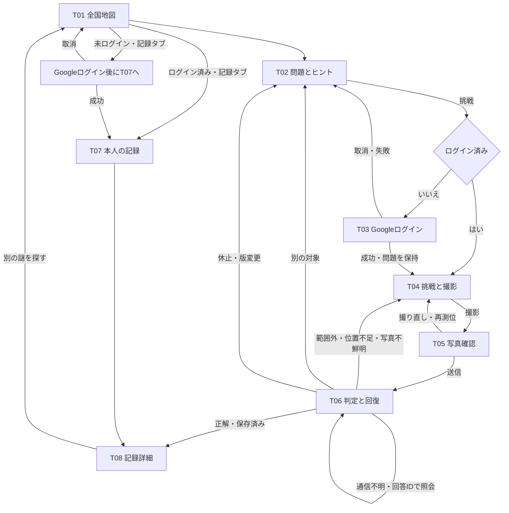
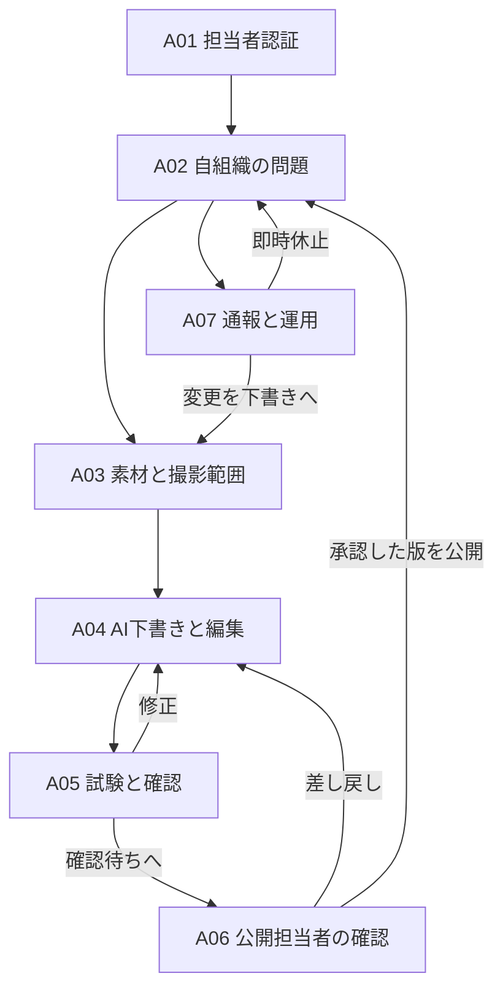

# 画面一覧・画面遷移・ラフ配置 v0.3

旅行者向けUIはT01/T02の一部とT03の認証を実装済み。地図の表示範囲は[旅行者向けUI](traveler-ui.md)に記載する。T04/T05では撮影と測位ができ、利用者の操作でローカルAPIに写真と位置を送信する。永続側では合成照合からクリア確定・本人記録保存へ接続済み。実Vertex回答は共有環境の承認済み4人限定試験に限る。[審査手順と確認範囲](team-preview.md#提出・審査で使う手順)を参照。[撮影とデモ送信](camera-preview.md)

以下の画面一覧と遷移は、完成時の設計を示す。画面IDはAPIと受け入れ条件でも共通して使う。

## 1. 旅行者の画面

| ID | 画面 | 主な要素・操作 |
|---|---|---|
| T01 | 全国地図 | 全画面の全国地図（シート表示中は幅を問わず画面全体を使う縁なし配置で、アプリ名・記録・ログイン等の導線は地図の上に浮く。D-26）、地域別件数、探索地域マーカー、地図上に浮く地方・都道府県の絞り込みチップ、選択中地域名の小チップ、拡大・移動、表示範囲に連動する問題カード一覧（下部のボトムシート）、任意の現在地、記録タブ |
| T02 | 問題詳細 | 問題文、探索地域、ヒント、部分写真、利用条件、挑戦、報告。広い画面（981px以上）では主導線が「スマホで挑戦する」＋QRコードになり、挑戦は副次的に残る（D-25） |
| T03 | Googleログイン | 元の問題を保持。成功でT04、取消・失敗でT02へ戻る |
| T04 | 挑戦・撮影 | カメラと位置の許可説明、プレビュー、撮影、取得状態、戻る |
| T05 | 写真確認・送信 | 写真、左右90度回転、撮り直し、保存・AI送信の説明、送信。回転画像を送信し、GPSと撮影時刻を保持 |
| T06 | 判定と回復 | 処理中、正解、範囲外、位置不足、別対象、確認不能、通信失敗 |
| T07 | 自分の記録一覧 | 本人の初回クリア写真・日付・地図。未ログイン時は認証入口 |
| T08 | 記録詳細 | スポット名、本人の写真、初回日付、クリア後の案内、地図へ戻る、削除入口 |

問題詳細・ヒントの閲覧にはログインも位置許可も求めない。段階ヒントは最初に1つ目だけを表示し、各ヒントの取得成功後に次の番号を表示する。開いたヒントを閉じても解放済みボタンは残る。問題・版を切り替えると1つ目から再開する。写真撮影に移るときは認証が必要。別画面への移動・取消ではカメラストリームや不要な位置追跡を止める。

ローカルAPIモードのT07/T08では、自分の記録タブからGoogleログインし、記録一覧や日付、本人の写真と詳細を見られる。削除は詳細画面で確認し、削除完了を照会してから一覧へ戻る。開発用の合成記録で確認する。永続側では本人記録の保存・削除へ接続済み。地図への発見の表示や実写真・実機の確認完了とは区別する。[本人記録の起動手順](owner-discoveries.md)

## 2. 旅行者の遷移

共有サイトの旅行者画面にある自治体画面への入口は、所属（membership）を持つアカウントでログインしている場合にだけ表示する。未ログイン・所属なしでは入口自体を描画しない。入口の表示は利便性のための制御であり、管理画面の保護は従来どおりサーバー側の所属チェックが担う。`/admin`への直接アクセス時の挙動は変えず、管理画面から旅行者画面へ戻る導線も残す。

問題詳細（T02）は端末で役割を分ける（D-25）。ビューポート幅981px以上（PC想定）では、主ボタンが「スマホで挑戦する」になり、その問題の詳細を直接開くURLのQRコードを表示する。従来の挑戦ボタンは副次的なボタンとして残る。981px未満（スマホ想定）では従来どおり挑戦ボタンが主導線である。判定は幅のみで行い、UAは使わない。問題を指定するディープリンクは `?area=<地域ID>&quest=<問題ID>` で、開くと読み込み後に該当問題の詳細が表示される（QRの飛び先もこの形式）。QRコードは端末内で生成し、URLを外部へ送らない。

探索画面（T01）は、地図が使えて問題カードがボトムシートに入る間、幅を問わず画面全体（100dvh）を使う縁なしレイアウトになる（D-26）。シェルのヘッダーと下部ナビの帯は無くし、アプリ名・自分の記録・ログイン／ログアウト・自治体画面への入口（所属がある場合のみ、D-24）は地図の上に浮く要素として置く。ただしスマホ幅（981px未満）では、主要ナビ（謎を探す／自分の記録／自治体画面への入口）は浮く要素にせず、画面下のタブバーに常時置く（D-32）。PC幅（981px以上）では、浮く要素とボトムシートをやめ、画面左の固定サイドバー（主要ナビ＋絞り込み＋表示範囲連動リスト）に集約し、地図は残りの領域に広げる（D-34）。サイドバーは端のトグルで閉じることができ、閉じると地図が全幅になる（D-36）。その場合、ボトムシートと地図上の浮動要素はタブバーの高さぶん持ち上げ、記録画面にも下部余白を確保する。地域が選択・フォーカスされている間は、その地域名をテーマの小さなチップで地図の上部に浮かせる（特大の地域名タイポは使わない）。記録画面など他の画面を開くと通常のシェルに戻る。地図が使えないフォールバック表示では縁なしにせず、従来の通常フローのままにする。

撮影前は「範囲内」と断定しない。撮影時の位置情報を写真とともに送信してサーバーで最終確認する。GPSが不十分なら危険な場所へ寄せる指示を出さず再取得を案内する。

## 3. T06の表示と処理

結果コードは[API設計](api.md)と一致させる。

| コード／状態 | 画面の動作 |
|---|---|
| PROCESSING | 二重送信を抑止。回答IDを保持し、再読込でも結果照会 |
| CORRECT | 保存完了後だけ正解表示。保存した写真・初回日付を案内 |
| ALREADY_CLEARED | 既存の初回記録へ。新しい写真で上書きしない |
| OUTSIDE_AREA | 撮影範囲外と案内。正解座標や残り距離を通常応答で明かさない |
| LOCATION_UNCERTAIN | 精度・古さ・取得失敗を案内し再測位。範囲を自動拡張しない |
| WRONG_TARGET | 別対象と案内し、ヒントか撮り直しへ |
| IMAGE_UNCERTAIN | 被写体が小さい等、秘密を過剰に明かさない撮影案内 |
| QUEST_UNAVAILABLE | 休止・利用不可。別の問題へ戻れる |
| QUEST_CHANGED | 新版を読み直して挑戦し直す。古い回答で新条件を判定しない |
| SYSTEM_ERROR | 不正解ではない。まず同じ回答IDを照会し、状態不明のまま連投しない |

401は再認証後に元の画面へ戻す。403は権限不足、429は再試行待ちを表示する。復帰後に写真の時刻が古くなっていたら新たに撮影する。端末メモリに一時保持した写真を無期限に残さない。

## 4. 地図とヒント

公開済み問題がある地域には、件数入りの探索地域マーカー（ピン）を表示する。マーカーは対象ではなく、公開探索エリアの代表点（外周の重心）に置く。対象を中心に生成しない。地図は画面いっぱいに広げ（全画面マップ）、シート表示の間はステージの高さ上限と枠を外してブラウザの表示領域全体（100dvh）を占める。ヘッダー・ナビ等のシェルの導線は帯ではなく地図の上に浮く要素として置き、選択・フォーカス中の地域名はテーマの小さなチップで地図の上部に浮かせる（D-26）。表示範囲と連動する問題カードのリストは下端の引き上げ式ボトムシートに入れる。シートは覗き見（件数と先頭カード1枚が丸ごと見え、そのまま押して詳細へ進める。覗き見の間、先頭カードはタイトル・地域名・問題番号のみの要約表示になり、注意書き・手がかり抜粋・サムネイルは出さない）／半開き／全開の3段にスナップし、ハンドルのドラッグとタップで開閉できる。ピンを選ぶとその地域の問題がシートの先頭に並び、開いた時にスクロールなしで見える。地図の移動・拡大縮小に合わせて、表示範囲に代表点がある地域の問題（タイトル、地域名、問題番号があれば「No. 40-01」のような小さなラベル、手がかり、公開ヒント画像があればサムネイル）をシートに並べる。マーカーを選ぶと地域が選択され、シートが半開きまで開いて、その地域の問題がシート側でハイライトされる。カードを選ぶと詳細へ進み、対応する地域が選択状態になる。地方・都道府県の絞り込みは地図の上部に浮くチップで選び、選ぶとその範囲の地域のマーカーと問題だけを表示する。地方チップはもう一度押すと解除され（都道府県の選択も外れる）、チップ未選択の状態が全国表示になる。「全国」「未分類」のチップは置かない。地域の都道府県は、公開探索地域に付けた都道府県コード（D-22）で分類し、地域名からは推測しない。コードの無い地域は地方の分類を持たず、地方・都道府県で絞り込んだ時は表示されず、未選択（全国表示）の状態で表示される。ピンは地域の代表点であり問題の場所そのものではない旨はリストに併記する（シートの覗き見状態では省き、半開き以上で出す）。表示範囲に問題がない場合はその旨を表示する。地図が読み込めない・キーがない場合はシートを使わず、全地域の問題を通常フローのリストから選べ、絞り込みチップも通常フローに置く。公開済み問題がない地域も移動でき、ゼロ件と通信失敗は別表示にする。現在地の取得に成功すると、地図上の現在地に矢印マーカーを表示し、再取得で更新する。共有検証モードで問題の選択肢から問題を選ぶと、対応する探索地域が選択され、地図がその地域へ拡大する（地図の上に重なる帯・チップ・シート等の分をパディングとして差し引き、実際に見えている領域の中央に収める。初期表示の全日本フィットも同じ考え方で、一度だけ地域全体にフィットする）。地域の選択を解除すると、地図は初期表示ではなく選択直前の中心・ズームに戻る（選択後に手動で動かしていた場合も、解除時は選択前の状態へ戻す）。アプリは日本国内専用（D-27）で、地図のラベルは読み込み時の指定により日本語・日本仕様に固定し、初期表示は日本全体、移動範囲は日本周辺に緩く制限する。

クリアした本人には記録を重ね、対象の位置を表示できる。他人の記録は表示しない。最後のヒントとして名前・撮影案内を開く救済は提案であり、「答えの案内を表示する」の明示操作を挟む。注意・通行条件は最初から公開する。

## 5. 自治体担当者の画面

開発用の後退である `/admin-demo` は[未認証の操作デモ](admin-demo.md)。A04では文章を手動編集し、AI未使用の架空サンプルを明示操作で読み込める。A05は管理画面内の表示プレビューだけで、実際の旅行者画面・写真判定試験・公開は未接続。非公開撮影地点・半径の値は表示・入力せず設定状態のみを示す。以下の画面一覧は実接続後も含む設計であり、自治体認可・素材保存・生成・公開の完了を意味しない。

開発サーバーの `/admin-local` ではA01のログインと所属確認、A02の自組織の問題一覧、A03/A04の下書き・参考写真・非公開撮影範囲の保存、A05/A06の合成写真試験と公開確認、公開担当者のA07報告一覧と休止を試せる。[起動と確認手順](admin-demo.md#開発用の所属問題報告を閲覧する)

A03の接続用に[認可付き撮影範囲API](admin-shooting-areas.md)を追加した。設定状態と値の取得/保存を区別し、公開プレビューへ座標を渡さない。既存の操作デモの動作は変えていない。

| ID | 画面 | 主な要素・操作 |
|---|---|---|
| A01 | 担当者ログイン | Google認証と所属・役割確認。未招待者には登録操作を出さない |
| A02 | 自組織の問題一覧 | 状態、保存済みデータから算出した残りの作業、新規作成、編集、試験、公開・休止 |
| A03 | 素材・場所登録 | 対象名、参考写真、写真の利用条件、公開探索エリア、非公開撮影地点・半径（永続側・共有サイトでは地図でも設定可）、根拠情報、撮影条件（船上・海上／有料施設内）、料金・撮影注意。クリア後用にアクセス・利用時間・自治体コメント・解説 |
| A04 | AI下書き・編集 | 問題、段階ヒント、部分写真、確認済み特徴、生成根拠。不明な情報を追加しない |
| A05 | プレビュー・試験 | 挑戦前の問題（撮影条件アイコン・料金・注意）とクリア後の解説を分けて表示確認。写真試験は合成フィクスチャ専用で、画面からダウンロード可能（共有検証で回答試験を有効にした場合は実写真のVertex照合、D-18）。正解／類似別対象での写真判定・確認記録は未接続 |
| A06 | 公開確認 | 利用条件、写真権利、撮影範囲、試験、公開する版を確認。編集担当には公開担当者の確認欄を読み取り専用で表示 |
| A07 | 運用 | 問題報告、修正、休止、再公開。旅行者の全写真閲覧機能は設けない |

編集中でも旧公開版は固定。休止は即時に新規挑戦・判定確定を止める。再公開時も確認・試験を行う。同じ対象に紐付けた問題を別の建物へ差し替えず、新しい対象として登録する。

## 6. 主要画面のラフ配置（文章ワイヤーフレーム）

T01：画面全体（100dvh）に広がる全国地図。アプリ名・自分の記録・ログイン／ログアウト・自治体画面への入口（所属がある場合のみ）は帯ではなく地図の上に浮く要素として置く。地図の上部に地方・都道府県の絞り込みチップと、選択・フォーカス中の地域名の小チップが浮き、下部に表示範囲と連動する問題カード一覧のボトムシート（普段は見出しと先頭カードだけ覗き、引き上げると広がる。PCでは最大幅付きの浮きカード）。右下にズーム操作と丸い現在地ボタンがシートの上端に追随して浮く。問題詳細は地図の下に読みやすい幅で置く。現在地ボタンは任意で、アプリ起動直後の許可を強制しない。

T02：タイトル→問題文→探索地域→利用条件→ヒント→「挑戦する」。広い画面では末尾の主導線が「スマホで挑戦する」＋QRコードになり、「挑戦する」はその下に副次的に置く（D-25）。参考全景・答え・撮影中心座標は通常表示しない。段階ヒントは何を開くか分かるラベルにする。

T04/T05：撮影対象の枠は参考のみ。位置取得の状態を文章でも表示。写真確認画面は「撮り直す／回答を送信」の2操作を主にし、撮影前説明へのリンクを残す。

T08：本人の写真を大きく、その下にスポット名・初回日付・クリア後の案内。案内は入力済みのアクセス、利用時間、自治体からの紹介、解説を表示する。解説が空欄のときは記録済みの解説を使う。「地図に戻る」を主要操作にし、再訪回数やランキングを置かない。

A03〜A06：PCでも使える登録フォーム。素材、場所、生成・編集、試験・公開の順に進む。位置は「公開する探索エリア」と「非公開の判定範囲」を別欄にし、混同を防ぐ。

### 2026-11-08 永続側の操作短縮

A03/A04では理由・対象名の未入力で文章編集を止めない（対象名の公開条件は維持）。既存メモは保持し入力を要求しない。保存して範囲、ヒント番号に対応する画像、A06へ進み、一覧なしで本文編集へ戻る。A06の試験証跡復元は未対応。T01は問題カードからT02を直接開き地域一覧を地図の代替として保持する。T03は明示挑戦の認証だけを期限・版・本人・画面世代で継続し、T04のサーバー確認後に撮影する。T06は最大6回の自動GET照会から保存済みIDのT08へ進む。上限／時間切れは失敗確定にせず手動照会を残す。

永続側A03〜A06の地図・時間・料金・写真権利の入力支援は[管理入力支援](admin-input-ux.md)を参照。保存API/strict schema/公開DTOの変更はなく、既存文字列と非公開範囲専用APIを使用する。
